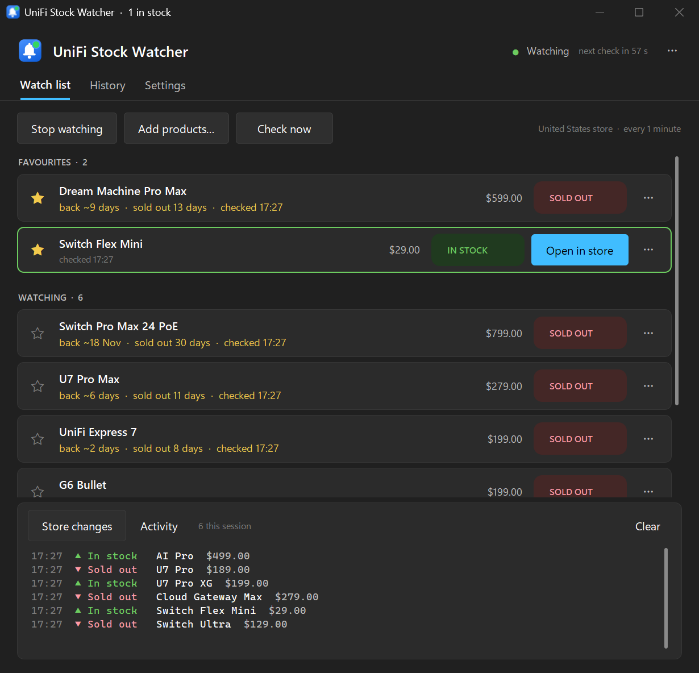

# UniFi Stock Watcher

[](https://github.com/jamesccupps/UnifiStockWatcher/releases/latest)
[](https://github.com/jamesccupps/UnifiStockWatcher/actions/workflows/ci.yml)
[](https://github.com/jamesccupps/UnifiStockWatcher/actions/workflows/contract.yml)
[](LICENSE)

Tells you the moment something you want is back in stock on the Ubiquiti Store (store.ui.com). Pick the
products from the live catalog; the app checks the whole store on a timer and alerts you with a notification,
a sound and the product's page in your browser. It sits in the notification area and can start with Windows.

**[⬇ Download for Windows](https://github.com/jamesccupps/UnifiStockWatcher/releases/latest/download/UnifiStockWatcher-Setup.exe)**
(`UnifiStockWatcher-Setup.exe`, Windows 10 or 11, 64-bit) ·
[Portable zip](https://github.com/jamesccupps/UnifiStockWatcher/releases/latest/download/UnifiStockWatcher-win64.zip) ·
[All releases](https://github.com/jamesccupps/UnifiStockWatcher/releases) ·
[Website](https://jamesccupps.github.io/UnifiStockWatcher/)



<sub>Demo mode: a sample catalog with made-up stock, prices and dates.</sub>

- **The whole store, every check.** Each check reads the full UniFi catalog (about 490 products, 8 requests)
  whether you watch one product or fifty, and the feed at the bottom shows everything that came into or went out
  of stock anywhere in the store.
- **Alerts that reach you.** A notification you can click to open the product, a sound, and the product's page
  opened in your browser, once each time something comes back. Each one is a switch in Settings.
- **On your phone too** (3.1). The same alert through ntfy, Pushover, Discord or Slack, or as JSON to any address
  (Home Assistant, n8n, …).
- **Only the alerts you want** (3.2). Mute one product without removing it, or alert only for favourites, here or
  just on the phone.
- **Price changes** (3.2). Every price change of a product you watch goes into the history, and a price drop can
  alert you too.
- **Restock estimates.** The store's own restock date and how long a product has been sold out, e.g.
  `back ~7 Nov · sold out 13 days`, on the watch list and in the catalog.
- **Runs in the background.** Closing the window keeps watching from the notification area. *Start with Windows*
  starts it there when you sign in.
- **History.** Every change to the products you watch (or to the whole store), kept between runs, searchable
  and exportable as CSV.
- **Signed updates.** It checks GitHub once a day and installs a new version with one click. A download is
  installed only if it carries the release signature built into the app and matches its signed checksum.
- **Looks at home on Windows 11.** Light and dark themes that follow Windows, in Windows' accent colour or one
  of your choosing, at any display scale.
- **Four stores.** United States, Europe, United Kingdom and Canada.
- **A command-line watcher** too, for a server or Task Scheduler.

No account, no API key and nothing to configure: the app reads the store's public catalog, the same data its web
pages are built from, at a polite interval (every minute by default).

## Install

**Installer (recommended):** download
[`UnifiStockWatcher-Setup.exe`](https://github.com/jamesccupps/UnifiStockWatcher/releases/latest/download/UnifiStockWatcher-Setup.exe)
and run it.

- It installs for your Windows user only, with no admin prompt, into `%LOCALAPPDATA%\Programs\UniFi Stock Watcher`.
- It adds a Start menu shortcut (and a desktop one if you tick it) and appears in **Settings → Apps** for
  uninstalling.
- The app isn't code-signed, so Windows may show *Windows protected your PC* the first time: click **More info**,
  then **Run anyway**. Each release lists the SHA-256 of every file in `SHA256SUMS.txt`.

**Portable:** download
[`UnifiStockWatcher-win64.zip`](https://github.com/jamesccupps/UnifiStockWatcher/releases/latest/download/UnifiStockWatcher-win64.zip)
and unzip it somewhere of your own, e.g. a USB stick or `%LOCALAPPDATA%\Programs`. It keeps its watch list and
settings in its own folder (that's what the `portable.txt` beside it does), and updates itself in place. Avoid
`C:\Program Files`, which it can't write to.

**From source:** Python 3.10 or newer, then `pip install -r requirements.txt` and `python unifi_watcher_gui.py`
(or double-click `install_and_run.bat`).

## Use

1. Click **Add products…**. The store's catalog opens: search it, pick a category, tick the products you want.
   Sold-out products are shown first; tick **Include products in stock** to see everything.
2. Click **Start watching**. The first check sets a baseline; every check after that compares the whole store
   with the one before.
3. When a product you watch comes back, you get the alert, its card turns green and gets an **Open in store**
   button.

- **★** pins a product to the Favourites at the top. **⋯** on a card (or a right-click) has *Check now*, *Copy link*,
  *Mute alerts* and *Remove*. Double-click a card to open its page.
- A muted product (a crossed-out bell on its card; click the bell to unmute) is still checked and kept in the
  history, but doesn't alert. **Settings → Alerts → Only for favourites** does the same for every product that isn't
  starred, and **Settings → Alerts on your phone → Only for favourites** keeps the others off the phone and on the
  PC.
- **Settings → Alerts → Tell me when a price drops** alerts you (a notification, and your phone if that's on) when a
  product you watch gets cheaper. The history keeps every price change either way, even one that happened while
  the app was closed.
- **Check now** (F5) checks straight away, watching or not. Ctrl+N opens the catalog; Ctrl+1/2/3 switch tabs.
- The bottom panel has two views: **Store changes** (everything that changed anywhere in the store) and
  **Activity** (what the watcher did). Drag its top edge to resize it.
- **History** lists the changes to your watched products, or to the whole store. Double-click a line to open the
  product; **Export CSV…** saves the lot.
- **Settings** take effect as you change them: how often to check, the store, the alerts (on your phone too),
  Start with Windows, the theme and accent colour, text size, and importing or exporting the watch list.
- The tray icon is grey when idle, blue while watching, and gets a green dot when something you watch is in
  stock. Click it to open the window; right-click for Start/Stop, Check now and Quit.

## Alerts on your phone

New in 3.1. **Settings → Alerts on your phone** sends every alert to your phone as well, through the service you
choose. The app on your PC sends it when it finds the product, so the PC has to be on and watching. **Send a
test** sends one straight away and shows what the service answered; the **Activity** view notes every alert
sent, or why one wasn't.

| Service | What to enter |
|---|---|
| **ntfy** (free, no account) | Install the ntfy app (links on [ntfy.sh](https://ntfy.sh/)), subscribe to a topic with a name nobody would guess (anyone who knows the name can read it), and enter its address, `https://ntfy.sh/<the-name>`. A server of your own works too, and a protected topic takes an access token. |
| **Pushover** (paid, after a free trial) | Your user key, from [pushover.net](https://pushover.net/)'s front page once you've signed in, and the API token of an application you create there (call it UniFi Stock Watcher). |
| **Discord** | A channel's webhook: the channel's settings → Integrations → Webhooks → New Webhook → Copy Webhook URL. The Discord app notifies you of the messages in that channel. |
| **Slack** | An incoming webhook for a channel: create a Slack app at [api.slack.com/apps](https://api.slack.com/apps), then Incoming Webhooks. |
| **Any address (JSON)** | Any `https://` or `http://` address: a Home Assistant webhook trigger, n8n, Zapier, IFTTT, a server of your own. |

An address that isn't reachable, or a service that's busy, is tried twice more over about 25 seconds. The
addresses and keys stay in `settings.json` in your data folder; the log only ever names the service or the host.

Any address gets a POST with this JSON. `event` is `in_stock`, `price_drop` (with the old price in
`product.price_was`; null otherwise), or `test`, when `product` is `null`:

```json
{
  "event": "in_stock",
  "app": "UniFi Stock Watcher",
  "version": "3.2.0",
  "time": "2026-10-29T14:05:12+00:00",
  "title": "Back in stock: Dream Router 7",
  "text": "Available on the United States store for $279.00.",
  "url": "https://store.ui.com/us/en/products/udr7",
  "store": "us",
  "product": {"title": "Dream Router 7", "slug": "udr7", "price": "$279.00", "price_was": null,
              "favourite": false}
}
```

## Where it keeps things

- `%APPDATA%\UniFi Stock Watcher\` holds `watched_items.json` (the watch list), `settings.json`,
  `stock_history.json`, `category_cache.json` and `unifi-stock-watcher.log`. **Settings → About → Open folder**
  goes there.
- A portable copy keeps the same files beside `UnifiStockWatcher.exe` instead. Delete `portable.txt` to make it
  use `%APPDATA%`.
- Coming from 2.x? Its files were kept beside the program. The first time 3.0 starts, it copies them into
  `%APPDATA%` (it never moves or overwrites anything). Unzipping the portable 3.0 over a 2.x folder keeps using
  them in place.

## Updates and privacy

The app talks to two places, and a third if you ask it to:

- `store.ui.com`, to read the catalog: one check is 8 requests, at the interval you choose (1 minute by default,
  never faster than 15 seconds). Once a day it also reads the store's home page, to notice new product
  categories.
- GitHub, once a day, for this project's `latest.json` (turn it off in **Settings → Updates**). Nothing is
  downloaded until you click **Install**. Installed copies then run the new installer silently and restart;
  portable copies swap their program files in place and restart, and put everything back if that fails.
- The service you choose for [alerts on your phone](#alerts-on-your-phone), if you turn them on: each alert, with
  the product's name, price (and old price, for a price drop) and link, and nothing else.

It sends nothing about you, your watch list or your PC anywhere. **Report a problem…** opens a GitHub issue form
with the version filled in, which you can edit and send yourself.

## Command-line watcher

`UnifiStockWatcher-cli.exe` (next to the app, in either kind of install) or `python unifi_watcher.py`:

```
UnifiStockWatcher-cli.exe            # watch (picks products the first time)
UnifiStockWatcher-cli.exe --setup    # pick the products again
UnifiStockWatcher-cli.exe --test     # check notifications, phone alerts and stock detection
UnifiStockWatcher-cli.exe --version  # the version, and where the files are
```

It uses the same watch list and settings as the app. Run it from Task Scheduler for a watcher without a window.

## Troubleshooting

| What you see | Fix |
|---|---|
| No notification | Check **Settings → Alerts → Show a notification**, then Windows' *Settings → System → Notifications* for UniFi Stock Watcher, and Focus / Do not disturb. **Send a test alert** shows one. A muted product (crossed-out bell), or one that isn't a favourite with **Only for favourites** on, never alerts; the **Activity** view says *no alert* and why. |
| Nothing on the phone | **Settings → Alerts on your phone → Send a test** shows what the service answered, e.g. *HTTP 404 (Unknown Webhook)* for a deleted Discord webhook. For ntfy, check the app is subscribed to exactly the topic in the address. The PC has to be on and watching. |
| "Couldn't reach the store" | The store or your connection is down; the watcher keeps trying at every interval. |
| A product shows **DELISTED** | The store doesn't list it any more (renamed or discontinued). Remove it, and add the new one from the catalog. |
| Stock looks wrong for one product | [Open an issue](https://github.com/jamesccupps/UnifiStockWatcher/issues/new?template=bug_report.yml) with its store link. A nightly check against the real store catches most changes on Ubiquiti's side the day they ship. |
| The window is gone | It's in the notification area (click the tray icon). Starting the app again also brings it back. |
| "Windows protected your PC" | **More info → Run anyway**. The app isn't code-signed. |
| The update didn't install | Details are in `update.log` in the data folder. The previous version keeps running; the release page always has the full installer. |

## Uninstalling

**Settings → Apps → Installed apps → UniFi Stock Watcher → Uninstall** removes the program, its shortcuts and its
Start with Windows entry. Your watch list and settings stay in `%APPDATA%\UniFi Stock Watcher`; delete that
folder too if you don't need them. A portable copy: delete its folder.

## How it works

The store is a Next.js site. The app reads its `buildId` from the home page (cached for five minutes, per store),
then the category pages' data at `/_next/data/{buildId}/{region}/category/....json`, concurrently over one pooled
connection, and reads each product's variant `status` (`Available`, `SoldOut`, `ComingSoon`), price, and
`restockEtaAt` / `soldOutAt`. A product the category pages don't carry is looked up by its own page, which for
about half the catalog answers HTTP 200 with a redirect *in the body* (`__N_REDIRECT`) or a bare 307 with
`x-nextjs-redirect`; the app follows both and picks the product by slug, `historicalSlugs`, then
`currentProductId`, and says *delisted* rather than guessing when nothing matches.

Ubiquiti renames categories now and then (cameras moved from `all-cameras-nvrs` to `all-physical-security`), so
category fetches follow the store's redirects, and once a day the app adopts any new category that carries
products the built-in list misses. A [nightly job](.github/workflows/contract.yml) checks all of this against the
real store and opens an issue when it breaks.

## Building and development

```
pip install -r requirements.txt -r requirements-dev.txt
python -m pytest                       # the offline suite (the store is faked), ~15 s
python -m pytest tests_live            # contract tests against the real store
python scripts/demo.py                 # the app against a pretend store
python scripts/build_windows.py        # dist\: the program folder, the zip, and with Inno Setup 6 the installer
```

CI runs the suite on Windows and Linux for Python 3.10 to 3.14, then builds the Windows release files, runs the
built app's self-test, and installs, self-tests and uninstalls the installer. A version tag (`v3.0.0`) builds,
signs and publishes the release. [CLAUDE.md](CLAUDE.md) has the architecture, the release process and what was
learned along the way; [ROADMAP.md](ROADMAP.md) what's planned.

## License

MIT: see [LICENSE](LICENSE). The libraries inside the Windows build are listed, with their licenses, in
[THIRD-PARTY-NOTICES.md](THIRD-PARTY-NOTICES.md).

UniFi Stock Watcher is an independent project, not made, endorsed or supported by Ubiquiti. UniFi is a trademark
of Ubiquiti Inc.
